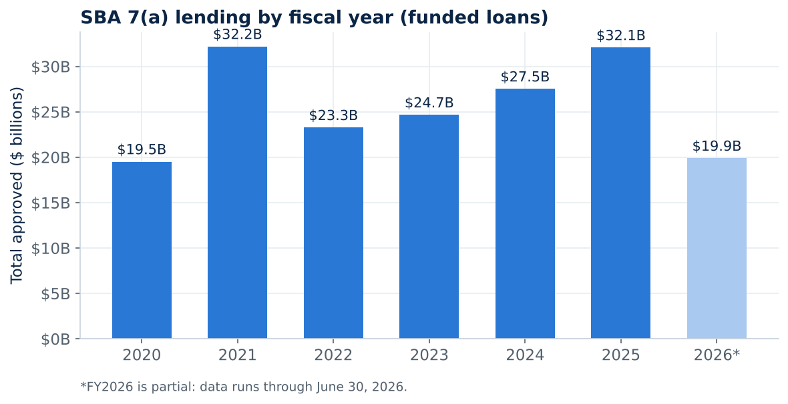
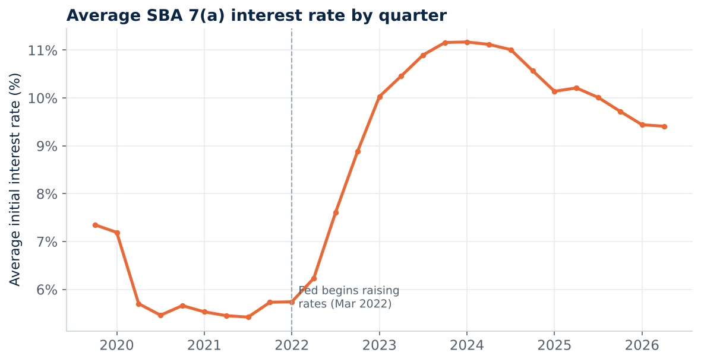
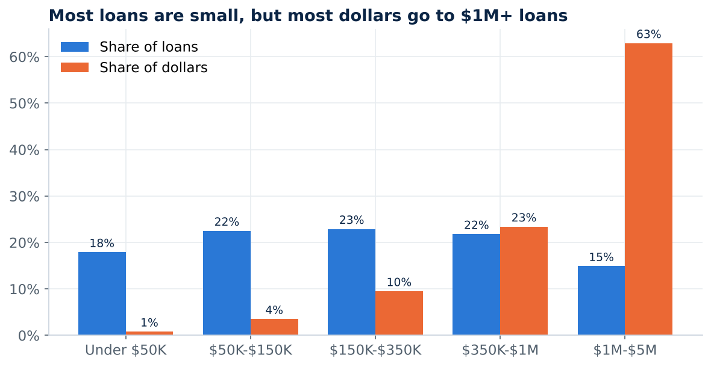
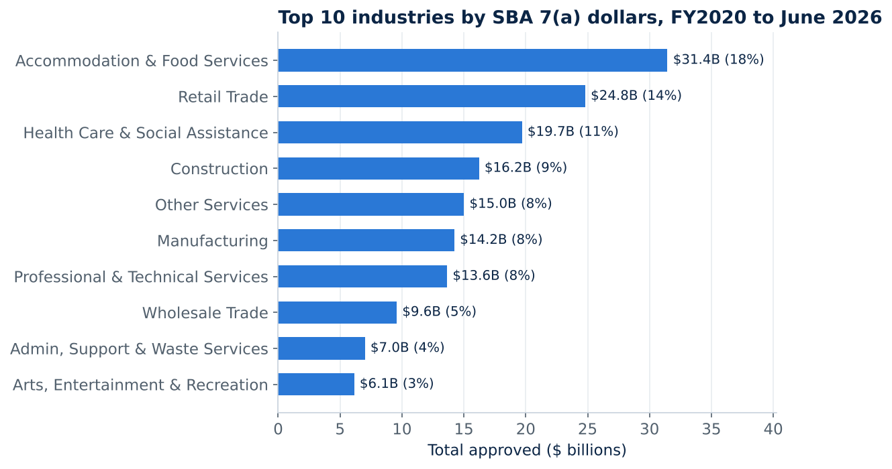
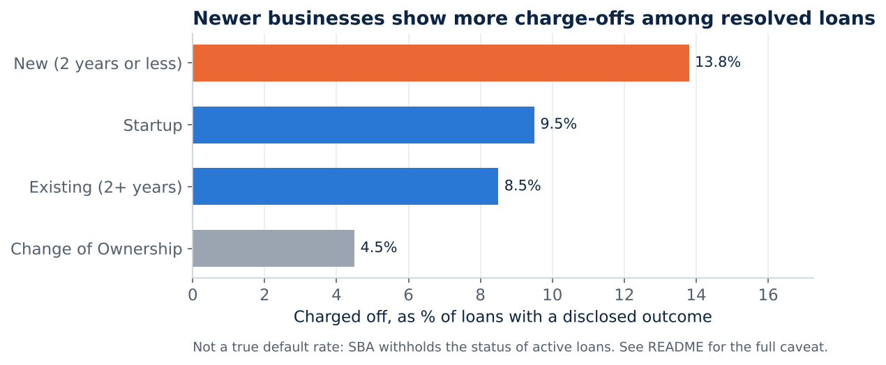

# Small Business Lending: Where $179 Billion in SBA Loans Went

An end-to-end analysis of every funded SBA 7(a) small business loan from October 2019 to June 30, 2026, using official U.S. Small Business Administration data. The project answers which industries, loan products, lenders, and places receive small business credit, what that credit costs, and how Virginia and the Richmond region compare with the rest of the country.

**Tools:** Python (pandas, matplotlib), SQL (SQLite), Excel, Jupyter, with a Tableau-ready extract

**Live report:** [tresmith26.github.io/small-business-lending/report](https://tresmith26.github.io/small-business-lending/report/)



## Business questions

1. How has SBA 7(a) lending changed from year to year, and how did rising interest rates affect it?
2. Which industries receive the most lending dollars?
3. How do the main loan products differ in size, rate, term, and SBA guarantee?
4. Do startups and newer businesses receive different terms than established businesses?
5. How concentrated is the lender market?
6. Which states receive the most lending, and how does Virginia rank?
7. How does lending in Virginia and the Greater Richmond region compare with the national pattern?

## Key findings

**1. Lending grew through the rate spike instead of shrinking.** The average initial rate rose from 5.42% in 2021-Q3 to 11.17% in 2024-Q1, after the Federal Reserve began raising rates in March 2022. Lending still grew every year from FY2022 to FY2025. FY2025 reached $32.1 billion, essentially tied with the FY2021 peak of $32.2 billion, but across 41% more loans (64,096 vs. 45,360), because the average loan shrank from about $710,000 to about $500,000.



**2. Most loans are small, but most dollars go to large loans.** Loans under $150,000 are 40% of all loans but only 4% of dollars. Loans of $1 million or more are 15% of loans but 63% of dollars. SBA Express loans are 39% of loans but under 8% of dollars, with an average of $104,770, a smaller SBA guarantee (52% vs. 79%), and a higher average rate (9.22% vs. 8.60% for Preferred Lender loans).



**3. Restaurants and hotels receive the largest share of dollars.** Accommodation & Food Services received $31.4 billion (17.6% of dollars). With Retail (13.8%) and Health Care (11.0%), the top three industries account for 42% of all dollars. Construction has the most loans (43,592) but ranks fourth by dollars because its loans are smaller.



**4. Ten lenders control about a quarter of the market.** About 2,150 lenders made at least one loan, but the top 10 hold 27% of dollars and the top 50 hold 56%. Live Oak Banking Company leads in dollars (7.3%) with an average loan of $1.36 million, while Huntington makes the most loans (38,974) at an average of $258,429.

**5. Newer businesses show more charge-offs among closed loans.** Among loans with a disclosed outcome, 13.8% of loans to businesses two years old or younger were charged off, compared with 8.5% for established businesses and 4.5% for ownership changes. This is not a default rate (see Limitations).



**6. Virginia ranks 18th nationally.** Virginia received $3.14 billion across 5,686 loans (1.8% of national dollars). Restaurants and hotels take 22.1% of Virginia dollars (vs. 17.6% nationally), and professional and technical services take 12.6% (vs. 7.6%). In the Richmond region, Henrico ($151.0M) and Chesterfield ($140.2M) each received more than twice the dollars of Richmond City ($64.0M), which also has the smallest average loan of the four localities.

## Data

| | |
|---|---|
| Source | U.S. Small Business Administration, [7(a) & 504 FOIA dataset](https://data.sba.gov/dataset/7a-504-foia) |
| File | FOIA - 7(a) (FY2020-Present), as of June 30, 2026 |
| Size | 388,338 approved loans, 42 fields, about 180 MB |
| License | Public domain |
| Definitions | SBA's official data dictionary (`data/raw/7a_504_foia_data_dictionary.xlsx` after download) |

The raw file is too large for GitHub, so it is not stored here. `data/download_data.py` downloads it from SBA.

## Method

1. **Cleaning (Python, `src/clean.py`).** Removed 50,104 cancelled loans that were approved but never funded, so the analysis covers 338,234 funded loans. Dropped borrower names and addresses. Mapped 6-digit NAICS codes to 20 industry sectors, grouped 18 SBA processing methods into 4 product families, added loan size bands, and flagged FY2026 as a partial year.
2. **Database (`src/build_db.py`).** Loaded the clean data into a SQLite table with indexes on fiscal year, state, and sector.
3. **Analysis (SQL, `sql/analysis_queries.sql`).** Twelve queries, one per business question, using aggregations, subqueries, CTEs, and window functions (`RANK`, `ROW_NUMBER`). `src/run_queries.py` runs them all and saves the results to `outputs/`.
4. **Charts (`src/make_charts.py`)** and a walkthrough notebook (`notebooks/sba_7a_analysis.ipynb`).
5. **Excel (`excel/SBA_7a_Lending_Analysis.xlsx`).** A SUMIFS-driven summary, a state explorer with a dropdown, and every Virginia loan ready for PivotTables. The workbook totals reconcile exactly to the SQL results.
6. **Tableau (`tableau/`).** An aggregated 166,573-row extract and a step-by-step guide for building the dashboard.
7. **Report (`report/index.html`).** An interactive findings page built from the SQL outputs by `src/build_report.py`.

## Limitations

- **No true default rate.** SBA withholds the status of active loans (`EXEMPT`, 72% of funded loans) under FOIA Exemption 4. Charge-offs can only be compared among loans that have already ended, which skews toward early payoffs and early failures, so those figures are directional only.
- **FY2026 is partial and starts late.** The file contains no FY2026 approvals before November 13, 2025. That gap lines up with the 43-day federal shutdown, which SBA said "halted approvals within SBA's flagship 7(a) and 504 programs" ([SBA, Nov. 13, 2025](https://www.sba.gov/article/2025/11/13/shutdown-blocks-sba-delivering-5-billion-small-businesses-amid-trump-economic-comeback)).
- **Approved amounts, not balances.** Dollar figures are approved loan sizes, not amounts drawn or still owed.
- **Jobs are self-reported.** SBA states that jobs created and retained are lender estimates it does not review or audit, so they are not used in the findings.
- **Unweighted averages.** Average rates treat every loan equally regardless of size.

## How to reproduce

```bash
pip install -r requirements.txt
python data/download_data.py       # about 180 MB from data.sba.gov
python src/clean.py
python src/build_db.py
python src/run_queries.py
python src/make_charts.py
python src/build_excel_tableau.py
python src/build_report.py
```

SBA updates this file every quarter. If the file name has changed, update it in `data/download_data.py` and `src/clean.py`, and the numbers will shift slightly.

## Repository structure

```
data/download_data.py         downloads the SBA source files
src/                          cleaning, database, query runner, charts, Excel/Tableau, report
sql/analysis_queries.sql      all 12 analysis queries
notebooks/                    step-by-step walkthrough
outputs/                      query results as CSV
images/                       charts
excel/                        Excel workbook
tableau/                      Tableau extract and dashboard guide
report/                       interactive findings page
```

## Sources

- U.S. Small Business Administration, [7(a) & 504 FOIA dataset](https://data.sba.gov/dataset/7a-504-foia) and data dictionary.
- Federal Reserve, [FOMC statement, March 16, 2022](https://www.federalreserve.gov/newsevents/pressreleases/monetary20220316a.htm).
- U.S. Small Business Administration, [news release, November 13, 2025](https://www.sba.gov/article/2025/11/13/shutdown-blocks-sba-delivering-5-billion-small-businesses-amid-trump-economic-comeback).

Author: Trevon Smith
